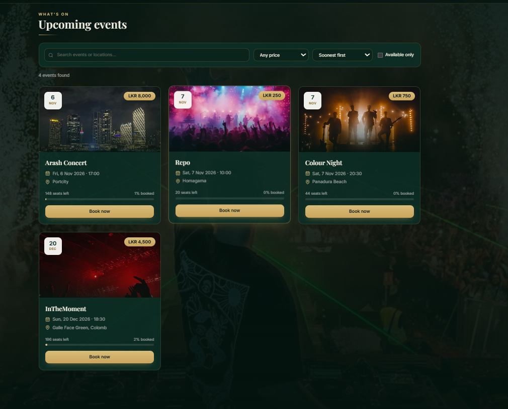
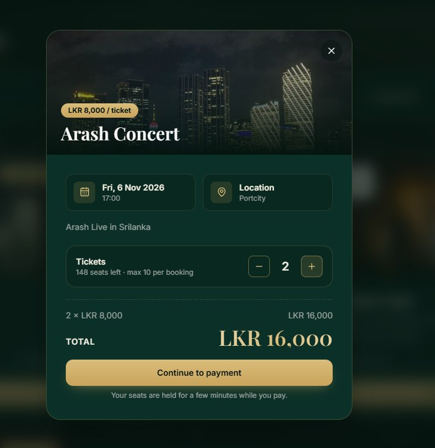
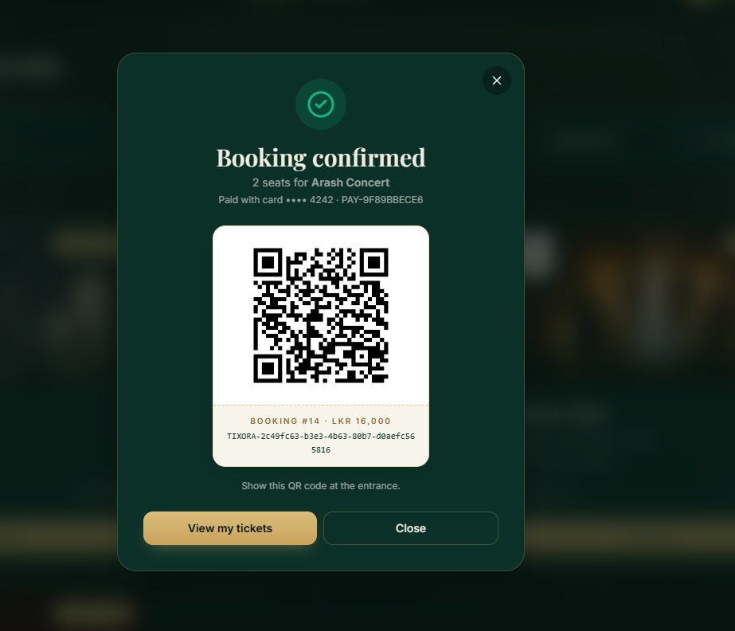
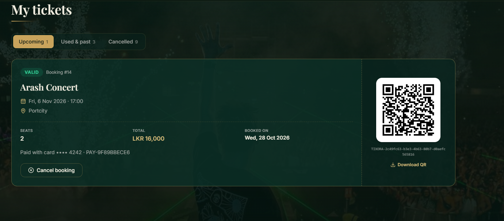
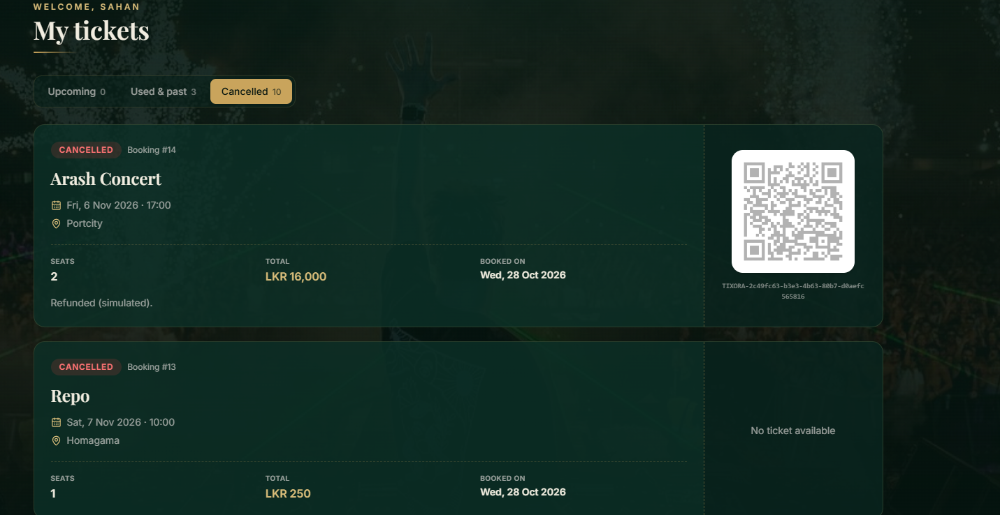
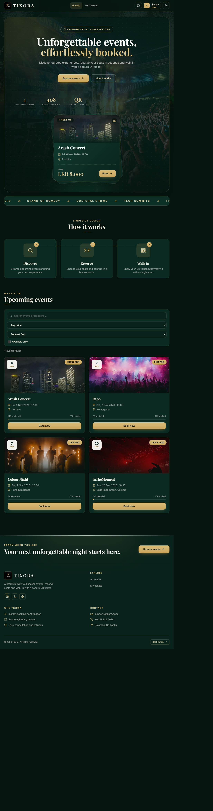

# Tixora: Event Booking & Reservation System

A full-stack event booking platform with **simulated card checkout** and **QR ticket verification**. Guests browse events, reserve seats, pay at a demo checkout and receive a unique QR ticket. Staff verify tickets at the entrance, and each ticket can only be used once.

  

## Screenshots

### Booking and checkout

<table>
  <tr>
    <td width="50%"></td>
    <td width="50%"></td>
  </tr>
  <tr>
    <td align="center">Choose seats, then continue to payment. Seats are held while the guest pays.</td>
    <td align="center">The QR ticket is issued only after a successful payment.</td>
  </tr>
</table>

### My tickets

  

A paid ticket with its payment reference, QR code and cancel option.

  

Cancelled bookings release their seats and show a simulated refund.

<b>Full landing page (dark and light themes)</b>

 

<table>
  <tr>
    <td width="50%"></td>
    <td width="50%"></td>
  </tr>
</table>

## Features

- **Authentication:** JWT login and registration with `USER` and `ADMIN` roles
- **Events:** catalogue with search, price filter and sorting; admins create, edit and delete events and upload event images
- **Booking with seat holds:** seats are reserved for 10 minutes while the guest pays, then released automatically if payment is not completed
- **Simulated checkout:** card form with Luhn validation, approved, declined and insufficient-funds scenarios (no real money moves, card numbers are never stored)
- **QR tickets:** a unique QR code is issued only after a successful payment (ZXing)
- **My tickets:** upcoming, used/past and cancelled bookings, "Pay now" for unpaid reservations, cancellation with seat release and simulated refund
- **Admin verification:** paste or scan a ticket code to admit a guest; reused, unknown and cancelled tickets are rejected
- **UI:** responsive, dark and light themes, animated landing page

## How booking and payment work

1. The guest picks a number of seats. The server **locks the event row**, deducts the seats and creates the booking as `PENDING_PAYMENT` with a 10 minute hold. No ticket exists yet.
2. The guest pays on the checkout form. A successful payment turns the booking into `CONFIRMED` and the **QR ticket is generated**.
3. If the payment is declined the booking stays on hold and the guest can try again.
4. If the hold expires, a scheduled job releases the seats and marks the booking `CANCELLED`.
5. At the entrance, an admin verifies the ticket. The ticket is marked as used and cannot be scanned twice.

Free events skip the payment step and are confirmed immediately.

## Demo checkout test cards

Enter any cardholder name, any future expiry (for example `12/30`) and any 3-digit CVV.

| Card number | Result |
|---|---|
| `4242 4242 4242 4242` | Payment approved |
| `4000 0000 0000 0002` | Card declined |
| `4000 0000 0000 9995` | Insufficient funds |

Any other number that passes the Luhn check is approved.

## Tech stack

| Layer | Technology |
|---|---|
| Backend | Java 17, Spring Boot 3.5, Spring Security (JWT), Spring Data JPA (Hibernate), PostgreSQL, ZXing, Maven |
| Frontend | React, Vite, TypeScript, Tailwind CSS, Axios, React Router, Lucide icons |
| Testing | JUnit 5, AssertJ |

## Engineering highlights

- **Concurrency-safe seat deduction:** pessimistic row locking, so simultaneous bookings can never oversell an event
- **Scheduled seat release:** a background job frees seats from unpaid bookings after the hold expires
- **Double-use protection:** ticket verification locks the ticket row, so two scanners cannot admit the same ticket
- **Consistent error handling:** a global exception handler returns structured JSON errors with proper status codes (400, 401, 402, 403, 404, 409)
- **Validation and security:** bean validation on every request, BCrypt password hashing, role-based access with method security, secrets kept out of version control
- **Unit tests:** the payment simulator is covered by JUnit tests (approved, declined, Luhn failure, expired card)

## Getting started

### Prerequisites
JDK 17, Node.js 20+, PostgreSQL 15+

### 1. Database
Create an empty database named `tixora`.

### 2. Backend
Create `backend/src/main/resources/application-local.properties` (it is git-ignored):

    spring.datasource.password=YOUR_POSTGRES_PASSWORD

Then run:

    cd backend
    ./mvnw spring-boot:run

The API starts on http://localhost:8080 and a default admin account is created on first run.

You can also configure the app with environment variables instead of the local file:

| Variable | Purpose | Default |
|---|---|---|
| `DB_URL` | JDBC connection string | `jdbc:postgresql://localhost:5432/tixora` |
| `DB_USERNAME` | Database user | `postgres` |
| `DB_PASSWORD` | Database password | none, set it locally |
| `JWT_SECRET` | JWT signing secret (use a long random value) | placeholder |
| `ADMIN_PASSWORD` | Password of the default admin | `Admin@12345` |

The seat hold length is `app.booking.hold-minutes` (default 10).

### 3. Frontend

    cd frontend
    npm install
    npm run dev

Open http://localhost:5173

## Demo accounts

| Role | Email | Password |
|---|---|---|
| Admin | admin@tixora.com | Admin@12345 |
| User | register your own account from the Sign in page | |

## API overview

| Method | Endpoint | Access |
|---|---|---|
| POST | `/api/auth/register`, `/api/auth/login` | Public |
| GET | `/api/auth/me` | Authenticated |
| GET | `/api/events`, `/api/events/{id}` | Public |
| POST / PUT / DELETE | `/api/events`, `/api/events/{id}` | Admin |
| POST | `/api/uploads` | Admin |
| POST | `/api/bookings` | Authenticated (holds seats) |
| POST | `/api/bookings/{id}/pay` | Owner (simulated payment, issues the QR ticket) |
| GET | `/api/bookings/my` | Authenticated |
| POST | `/api/bookings/{id}/cancel` | Owner |
| POST | `/api/tickets/verify` | Admin |

## Project structure

    backend/   Spring Boot API (config, controller, dto, entity, exception, repository, security, service)
    frontend/  React app (components, context, hooks, lib, pages, types)
    docs/      Screenshots

## Roadmap

- Automated API and UI test suites
- Cloud deployment

## Author

Built by Sahan Tharuka.
